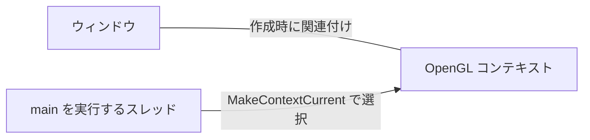

# 第1章：環境とウィンドウ

[目次](../README.md) · [次の章](02_render_loop_and_viewport.md) · [早見表](reference.md)

## プロジェクトの環境

| 名前 | 役割 | このプロジェクトでの場所・設定 |
| --- | --- | --- |
| CMake | コンパイルするファイルや、利用するヘッダ・ライブラリを指定する | `CMakeLists.txt`、C++17 |
| GLFW | ウィンドウと OpenGL コンテキストを作り、キーやマウスなどのイベントを扱う | `thirdParty/include/GLFW/`、`thirdParty/lib/libglfw3.a`。ヘッダのバージョンは 3.4 |
| GLAD | OpenGL 関数のアドレスを読み込み、プログラムから呼び出せるようにする | `thirdParty/include/glad/glad.h`、`thirdParty/src/glad.c`。GLAD 0.1.36 |
| OpenGL | 描画のための関数と、その動作を定める仕様。実際の処理はシステムやドライバが提供する | 現在のコードは 3.3 を要求。実際のバージョンはコンテキスト作成後に決まる |

この環境は macOS / arm64。CMake には Cocoa、IOKit、OpenGL のシステムフレームワークが設定済み。

参考：[OpenGL とは](https://learnopengl.com/Getting-started/OpenGL)、[環境の準備](https://learnopengl.com/Getting-started/Creating-a-window)。

## GLFW を初期化する：glfwInit

```cpp
if (glfwInit() != GLFW_TRUE) return -1;
```

`main` 関数の先頭で呼ぶ。GLFW が OS のウィンドウ機能や入力機能を利用するための準備をする。

- 引数：なし。
- 戻り値：成功は `GLFW_TRUE`、失敗は `GLFW_FALSE`。
- 失敗したら後続のウィンドウ作成へ進まず、プログラムを終了する。

ウィンドウと OpenGL コンテキストは、後で `glfwCreateWindow` を呼んだときに作られる。

呼び出す順序：`glfwInit` → `glfwWindowHint` で OpenGL のバージョンなどを指定 → `glfwCreateWindow`。

初期化に成功した場合、プログラムの終了時に `glfwTerminate()` で GLFW のリソースを解放する。初期化に失敗した場合の後始末は `glfwInit()` 内で行われる。

参考：[LearnOpenGL：Hello Window](https://learnopengl.com/Getting-started/Hello-Window)、[GLFW 初期化のリファレンス](https://www.glfw.org/docs/3.4/group__init.html)。

## 作成条件を指定する：glfwWindowHint

今回からは教材に合わせて OpenGL 3.3 Core を要求する設定を、順に追加する。

`glfwInit()` の成功を確認した行の下に、主バージョンと副バージョンの設定を追加する。

```cpp
glfwWindowHint(GLFW_CONTEXT_VERSION_MAJOR, 3);
glfwWindowHint(GLFW_CONTEXT_VERSION_MINOR, 3);
```

`glfwWindowHint(設定項目, 値)` は、これから作成するウィンドウやコンテキストの条件を設定する。`glfwInit()` の後、`glfwCreateWindow()` の前に呼ぶ。

| 引数 | この行での意味 |
| --- | --- |
| `GLFW_CONTEXT_VERSION_MAJOR` | OpenGL コンテキストの主バージョンを指定する設定項目 |
| `GLFW_CONTEXT_VERSION_MINOR` | OpenGL コンテキストの副バージョンを指定する設定項目 |
| それぞれの `3` | 主バージョンは 3.3 の左側、副バージョンは右側に相当する |

この 2 行で OpenGL 3.3 を要求する。次に Core Profile を指定する。

主・副バージョンを合わせて、作成するコンテキストが対応すべき最低バージョンを指定する。実際に作成されるコンテキストのバージョンは、要求より高い場合もある。

ここで設定するのは OpenGL のバージョン。GLFW のバージョンとは別のもの。

参考：[LearnOpenGL：Hello Window](https://learnopengl.com/Getting-started/Hello-Window)、[GLFW：コンテキストの作成条件](https://www.glfw.org/docs/3.4/window_guide.html#window_hints_ctx)。

### 新しいバージョン向けの GLAD でも、3.3 を指定してよい？

このプロジェクトの GLAD は、ファイル先頭に `APIs: gl=4.6` と記録されている。これは 4.6 までの関数を扱うために生成されたヘッダと読み込みコードであり、実行環境に OpenGL 4.6 が導入されたという意味ではない。

GLAD は実際のコンテキストのバージョンを調べ、それに応じた関数を読み込む。この GLAD を使って、3.3 の機能を学習できる。

`glfwWindowHint` で 3.3 を指定する意味は「3.3 以上に対応するコンテキストを要求する」。環境によっては、実際に 4.1 などの上位バージョンが作られることもある。対応できなければ、後のウィンドウ作成が失敗する。

3.3 用のファイルをダウンロードし直す必要はない。教材では 3.3 の範囲の機能を使って進める。

### Core Profile を指定する

バージョン指定の後、`glfwCreateWindow()` の前に追加する。

```cpp
glfwWindowHint(GLFW_OPENGL_PROFILE, GLFW_OPENGL_CORE_PROFILE);
```

`GLFW_OPENGL_PROFILE` はプロファイルを選ぶ設定項目。`GLFW_OPENGL_CORE_PROFILE` は、古い描画 API の多くを除いた Core Profile を選ぶ値。

バージョンが使える機能の世代を表すのに対し、プロファイルは利用する機能の構成を選ぶ。教材に合わせて Core Profile を使う。

macOS では OpenGL 3.2 以降は Core Profile のみ対応しており、ウィンドウ作成前にこの指定が必要。

設定を終えたら、すでに記入した `glfwCreateWindow()` でウィンドウと OpenGL コンテキストを作る。その次に、作成に成功したかを確認する処理を追加する。

参考：[GLFW：コンテキストの作成条件](https://www.glfw.org/docs/3.4/window_guide.html#window_hints_ctx)。

### macOS と前方互換：GLFW_OPENGL_FORWARD_COMPAT

```cpp
glfwWindowHint(GLFW_OPENGL_FORWARD_COMPAT, GL_TRUE);
```

要求した OpenGL バージョンで非推奨になっている機能を除いた「前方互換（forward-compatible）コンテキスト」を要求する。`GL_TRUE` は有効を表す値で、この引数では `GLFW_TRUE` と書いても同じ動作になる。

| 設定 | 役割 |
| --- | --- |
| `GLFW_OPENGL_CORE_PROFILE` | Core Profile という機能の構成を選ぶ |
| `GLFW_OPENGL_FORWARD_COMPAT` | 要求バージョンで非推奨の機能も除く、前方互換の条件を指定する |

macOS が提供する OpenGL 3.2 以降のコンテキストは、前方互換の Core Profile に限られる。

- GLFW 3.3：Core Profile と前方互換の両方の指定が必要。省略すると GLFW が作成を拒否する。LearnOpenGL の「macOS では追加が必要」という説明は、この扱いに対応する。
- GLFW 3.4：macOS の実装で前方互換の指定を必須とするチェックがなくなっている。Core Profile の指定は引き続き必要。

本プロジェクトは、ヘッダとリンク対象のライブラリのバージョン文字列がともに GLFW 3.4.0。この前方互換の行は省略可能だが、既に追加したまま進めても問題ない。

参考：[GLFW 3.3 の条件](https://www.glfw.org/docs/3.3/window_guide.html#window_hints_ctx)、[GLFW 3.4 の条件](https://www.glfw.org/docs/3.4/window_guide.html#window_hints_ctx)、[macOS の OpenGL 対応](https://www.glfw.org/docs/3.4/compat_guide.html#compat_osx)、[GLFW 3.4 の macOS 実装](https://github.com/glfw/glfw/blob/3.4/src/nsgl_context.m)。

## コンテキストとは何か

コンテキストは、OpenGL が「どんな設定で、どのリソースを使って描画するか」を管理する実行環境。OS やドライバが管理し、消去色や描画範囲などの状態、使用するリソースへの参照などを持つ。

描画によってできた画像そのものは、コンテキストではない。

| 名前 | 具体的な役割 |
| --- | --- |
| コンテキスト | 消去色などの描画設定や、使用するリソースを管理する |
| フレームバッファ | 描画先となるバッファのまとまり。描画結果の色は、そのカラーバッファに保存される |
| ウィンドウ | 描画結果を画面上で表示するための OS の窓 |

後で使う関数による説明用の例。実際に呼び出すのは、コンテキストを使用対象にして GLAD を初期化した後。

```cpp
glClearColor(1.0f, 0.0f, 0.0f, 1.0f); // 消去色を赤に設定する
glClear(GL_COLOR_BUFFER_BIT);        // その色で描画先のカラーバッファを塗る
```

1 行目は、現在のコンテキストに「消去色は赤」という状態を記憶させる。2 行目は、その状態を使って実際の色データを書き換える。

`glfwMakeContextCurrent(window)` で選ぶのは、これらの OpenGL 命令を実行するときに使うコンテキスト。描画済みの画像を選ぶ操作ではない。

参考：[LearnOpenGL：状態とコンテキスト](https://learnopengl.com/Getting-started/OpenGL)、[LearnOpenGL：消去色とカラーバッファ](https://learnopengl.com/Getting-started/Hello-Window)。

## 使用するコンテキストを指定する：glfwMakeContextCurrent

ウィンドウ作成の失敗を確認する `if` ブロックの後に追加する。

```cpp
glfwMakeContextCurrent(window);
```

`window` に関連付けられた OpenGL コンテキストを、現在のスレッドで使うコンテキストにする。以降、このスレッドからの OpenGL 呼び出しは、そのコンテキストに対して行われる。

`glfwCreateWindow()` はウィンドウとコンテキストを作成する。`glfwMakeContextCurrent()` は、作成済みのコンテキストを使用対象にする。

### 「ウィンドウとの関連付け」と「スレッドの使用対象」の違い

ウィンドウとコンテキストは、`glfwCreateWindow()` で作った時点ですでに関連付けられている。`glfwMakeContextCurrent()` が指定するのは、今のスレッドがどのコンテキストを使うか。



例えば `glClear(GL_COLOR_BUFFER_BIT)` のような OpenGL 関数には、ウィンドウを指定する引数がない。呼び出したスレッドで「現在のコンテキスト」として選ばれたものを使う。この関数の実際の使用は、GLAD の初期化後に学ぶ。

ウィンドウ A のコンテキストを使用中に、ウィンドウ B を作っても、現在のコンテキストは自動的に B に切り替わらない。A を使い続けることも、`glfwMakeContextCurrent(windowB)` で B に切り替えることもできる。

このように作成と選択を分けることで、複数のウィンドウやスレッドを扱える。一つのスレッドで現在のコンテキストにできるのは同時に一つ。一つのコンテキストを同時に複数のスレッドの現在のコンテキストにはできない。

呼び出す順序：ウィンドウ作成 → 作成失敗のチェック → コンテキストを使用対象にする → GLAD で OpenGL 関数を読み込む（次の段階）。

GLAD による OpenGL 関数の読み込みや、描画のための OpenGL 関数呼び出しより前に実行する。

参考：[GLFW：コンテキストと現在のコンテキスト](https://www.glfw.org/docs/3.4/context_guide.html#context_current)、[GLFW：コンテキストを現在のスレッドで使う](https://www.glfw.org/docs/3.4/quick_guide.html#quick_context_current)、[LearnOpenGL：Hello Window](https://learnopengl.com/Getting-started/Hello-Window)。

## OpenGL 関数を読み込む：gladLoadGLLoader

`glfwMakeContextCurrent(window)` の直後、イベントループの前に追加する。

```cpp
int gladLoaded = gladLoadGLLoader(
    reinterpret_cast<GLADloadproc>(glfwGetProcAddress)
);
```

GLAD は、現在のコンテキストで使える OpenGL 関数のアドレスを調べ、関数ポインタに保存する。これにより、`glClear` などの OpenGL 関数をプログラムから呼び出せるようになる。

| 部分 | 役割 |
| --- | --- |
| `gladLoadGLLoader` | OpenGL 関数のアドレスをまとめて読み込む、GLAD 1 の関数 |
| `glfwGetProcAddress` | 関数名からアドレスを調べる GLFW の関数。GLAD に検索役として渡す |
| `reinterpret_cast<GLADloadproc>(...)` | 渡す関数を、GLAD が受け取る関数ポインタ型に合わせる |

教材の C 形式のキャスト `(GLADloadproc)glfwGetProcAddress` は、ここでは C++ の `reinterpret_cast<GLADloadproc>(glfwGetProcAddress)` と書ける。異なる関数ポインタ型への変換にあたる。

今回初めて扱った `reinterpret_cast` は、ポインタを別の型として扱うなど、低水準の型変換を明示する C++ のキャスト。この例では、検索関数を GLAD 1 が定める関数ポインタ型に合わせて渡している。関数の実体を書き換えたり、新しい関数を作ったりする処理ではない。

例えば GLAD が `glClear` のアドレスを調べる際は、渡した `glfwGetProcAddress` を使う。OpenGL 関数ごとの読み込みを GLAD がまとめて処理する。

戻り値は `0` が失敗、`0` 以外が成功。`gladLoaded == 0` の場合は、ウィンドウ作成の失敗時と同じく、エラーメッセージを出し、`glfwTerminate()` を呼んで `return -1` で終了する。

現在の `main.cpp` のように、戻り値を変数に保存せず `if (!gladLoadGLLoader(...))` で直接チェックしてもよい。

読み込みはループの外で、このプログラムの初期化時に一度行う。`glfwGetProcAddress` は現在のコンテキストを必要とするため、`glfwMakeContextCurrent()` の後に置く。

次は、読み込んだ OpenGL 関数を使って背景色を指定し、描画結果を表示する。

参考：[GLFW：GLAD による関数の読み込み](https://www.glfw.org/docs/3.4/context_guide.html#context_glext_auto)、[LearnOpenGL：Hello Window](https://learnopengl.com/Getting-started/Hello-Window)。


---

[目次](../README.md) · [次の章](02_render_loop_and_viewport.md) · [早見表](reference.md)
