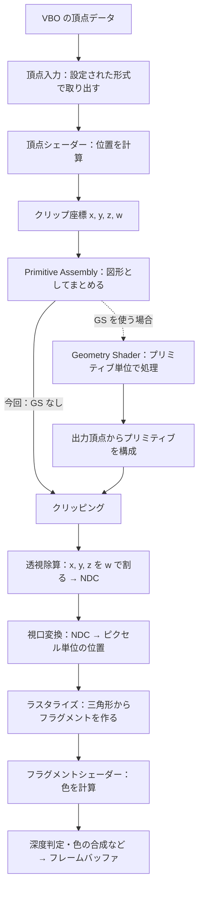

# 第3章：パイプラインと座標

[目次](../README.md) · [前の章](02_render_loop_and_viewport.md) · [次の章](04_vbo.md) · [早見表](reference.md)

図で確認する：[NDC と viewport の操作できる図](visuals/ndc-viewport.html)。

## 三角形の前に：パイプライン・座標・操作対象

### 頂点が画面の色になるまで

まず CPU 側の配列を VBO へコピーし、頂点データの読み方とシェーダーを用意する。その後、描画命令を出したときに、準備したデータを使って次の処理が進む。今回の三角形では Geometry Shader は使わない。図の点線は、それを使う場合の追加経路を表す。



シェーダーは GPU 上で実行する小さなプログラムで、OpenGL では GLSL という専用の言語で書く。

**頂点シェーダー**は、頂点ごとのデータを処理する。位置の出力先は GLSL の組み込み変数 `gl_Position` で、その値は 4 成分のクリップ座標。

**フラグメントシェーダー**は、ラスタライズによって作られた画素候補（フラグメント）の色などを計算するプログラム。最後に深度判定や色の合成などを経て、カラーバッファへ結果が書き込まれる。

シェーダーは開発者が書くプログラム。Primitive Assembly・クリッピング・透視除算・視口変換・ラスタライズは、自分でシェーダーとして書く処理ではなく、OpenGL が規定の方法で行う段階。

`glGenBuffers()`・`glBindBuffer()`・`glBufferData()` は入力データを準備する操作。この三つを呼んだだけでは、上の図形描画パイプラインは動かない。また、これまでの背景色表示は `glClear()` によるバッファの消去であり、頂点・フラグメントシェーダーを使った図形描画ではない。

### 応用から見る、処理を分ける理由

| やりたいことの例 | 主に変えるもの | 分離している利点 |
| --- | --- | --- |
| 同じ三頂点を、点・輪郭・面として表示する | 描画モード（Primitive Assembly の組み立て方） | 元の位置データを作り直さず、見せ方を変えられる |
| 三角形やキャラクターを移動・回転させる | 頂点シェーダーで使う変換 | 元の形状データを保持し、描く位置や向きを変えられる |
| 同じ形を赤や青にしたり、模様を付けたりする | フラグメントシェーダーでの色の計算 | 形状データと表面の見た目を分けて扱える |
| 点一つから、煙の粒子などを表す小さな四角形を作る | 使用する場合は Geometry Shader の出力 | 入力にない頂点を後段へ生成できる |

三角形が表示できた後に、`GL_POINTS` で頂点、`GL_LINE_LOOP` で閉じた輪郭、`GL_TRIANGLES` で面を描く比較を行う。`GL_LINE_LOOP` は最後の頂点から最初の頂点へも線を結ぶ。

### Primitive Assembly：頂点を図形の単位に組み立てる

Primitive（プリミティブ）は、点・線分・三角形などの基本的な描画単位。Assembly は、頂点の列を、指定した描画モードに従ってそれらの単位へ組み立てる処理。

例えば頂点が `v0, v1, v2, v3, v4, v5` と六つある場合：

| 描画モード | 組み立て方 |
| --- | --- |
| `GL_POINTS` | 各頂点を一つの点として扱い、合計六点 |
| `GL_LINES` | `(v0,v1)`、`(v2,v3)`、`(v4,v5)` の三本の独立した線分 |
| `GL_TRIANGLES` | `(v0,v1,v2)`、`(v3,v4,v5)` の二枚の独立した三角形 |

これは GLSL で書くプログラムではなく、OpenGL が行う組み立て。アプリケーションは描画命令でモードを指定する。

「3 個の float を一つの頂点として読む」という頂点入力の設定と、「3 頂点を一つの三角形としてまとめる」という Primitive Assembly は別の処理。今回なら、9 個の float → 3 頂点 → 1 個の三角形、となる。

### Geometry Shader：プリミティブ単位で処理する任意のシェーダー

Geometry Shader（ジオメトリシェーダー）は、頂点シェーダーで処理した位置などを、一つのプリミティブに属する頂点のまとまりとして受け取る GPU プログラム。例えば三角形なら、その三つの頂点をまとめて参照できる。

後段へ送る頂点を生成できるので、点一つから小さな三角形を作る、三角形一つから複数の図形を作る、何も出力せず図形を除く、といった処理ができる。頂点シェーダーのような頂点単位の処理とは、扱う単位と出力の仕方が異なる。

| 段階 | 扱う単位 | 自分で GLSL を書くか |
| --- | --- | --- |
| 頂点シェーダー | 頂点ごと | 書く |
| Primitive Assembly | 頂点列から点・線分・三角形を構成 | 書かず、描画モードを指定する |
| Geometry Shader | プリミティブごと | 使用する場合に書く |
| フラグメントシェーダー | フラグメントごと | 今回の図形描画では書く |

Geometry Shader は任意の段階で、プログラムに含めなければバイパスされる。最初の三角形では頂点シェーダーとフラグメントシェーダーを用意し、Geometry Shader は使わない。

Geometry Shader も透視除算より前に動作し、出力する位置はクリップ座標。その後のクリッピング・透視除算・NDC・視口変換という流れにつながる。

順序の注意：Geometry Shader にも、プリミティブとしてまとめた入力が必要。OpenGL 3.3 の仕様では頂点シェーダーと Geometry Shader の間に Primitive Assembly がある。Geometry Shader が出力した頂点からもプリミティブが構成され、後段へ進む。教材の図で Geometry Shader の後に Primitive Assembly だけが描かれていても、入力をまとめる処理が不要という意味ではない。

参考：[LearnOpenGL：Geometry Shader](https://learnopengl.com/Advanced-OpenGL/Geometry-Shader)、[OpenGL 3.3 仕様 §2.6・§2.12](https://registry.khronos.org/OpenGL/specs/gl/glspec33.core.pdf)。

### 入力座標・クリップ座標・NDC を区別する

| 段階 | 座標の意味 |
| --- | --- |
| 入力頂点の座標 | アプリケーションが決めた座標。メートルや画像のピクセルなど、使いたい基準で用意できる |
| クリップ座標 | 頂点シェーダー、または使用時は Geometry Shader が `gl_Position` に出力する `(x_c, y_c, z_c, w_c)` |
| NDC | クリップ座標の `x_c, y_c, z_c` を `w_c` で割って得る共通の座標 |
| Screen-space / window coordinates | NDC を視口へ対応付けた、フレームバッファ上の位置。ここでは x・y をピクセルで表す |

NDC は Normalized Device Coordinates（正規化デバイス座標）の略。解像度に依存せず、表示領域の中心・端を共通の数値で表すための座標系。

`(x_ndc, y_ndc, z_ndc) = (x_c / w_c, y_c / w_c, z_c / w_c)`

頂点シェーダーが直接出すのは NDC ではなくクリップ座標。Geometry Shader を使う場合は、その出力を後段へ渡す。`w` で割る透視除算は OpenGL が行う。例えばクリップ座標 `(100, 0, 0, 200)` の NDC は `(0.5, 0, 0)`。

`w` は透視投影などに使う 4 番目の成分。最初の三角形では、頂点シェーダーが入力位置を変えず、`w = 1` として出力する予定なので、入力の x・y・z と NDC の値が同じになる。

### なぜ −1 ～ 1 なのか

OpenGL 3.3 の通常の設定では、表示対象となる領域を、透視除算後に各軸 −1～1 となる共通の立方体で表す。実際の画面のピクセル数への変換は、その後の視口変換に分けられている。

「端を ±1 と呼ぶ」のは座標系の約束であり、C++ の配列に入れられる数値の制限ではない。入力頂点に 100 や 1000 を使ってもよく、頂点シェーダーで適切な位置へ変換する。OpenGL が配列の最大値・最小値を調べて、自動的に表示領域へ収めてくれるわけではない。

実際のクリッピングは透視除算の前、クリップ座標で行う。通常の表示領域の条件は `−w ≤ x ≤ w`、`−w ≤ y ≤ w`、`−w ≤ z ≤ w`。これを透視除算すると、NDC の −1～1 に対応する。

範囲外の頂点がある三角形でも、三角形全体が必ず消えるわけではない。表示領域にかかる部分を切り取って残せる。

### Screen-space と NDC の関係

この教材でいう screen-space は、ここではフレームバッファ上のピクセル座標と考える。OpenGL の仕様では window coordinates と呼ばれる。OS のデスクトップ上の位置や、GLFW のウィンドウサイズのスクリーン座標とは区別する。

`glViewport(x0, y0, W, H)` を設定すると、x・y は次のように対応付けられる。

- `x_screen = x0 + (x_ndc + 1) * W / 2`
- `y_screen = y0 + (y_ndc + 1) * H / 2`

例として視口を `(0, 0, 640, 480)` とした場合：

| NDC の x・y | 視口内のピクセル座標 |
| --- | --- |
| `(-1, -1)` | `(0, 0)`：左下端 |
| `(0, 0)` | `(320, 240)`：中心 |
| `(1, 1)` | `(640, 480)`：右上端 |
| `(-0.5, -0.5)` | `(160, 120)`：三角形の左下の頂点 |

この x・y は左下を基準とし、y の正方向は上。`(640, 480)` は領域の境界であり、最後の画素番号を表すものではない。

Retina などでフレームバッファが 1280×960 になれば、同じ NDC の位置でもピクセル座標は 2 倍になる。そのため、視口には `glfwGetFramebufferSize()` で取得した実際のピクセル数を使う。

### GL_ARRAY_BUFFER は何か

`GL_ARRAY_BUFFER` は、OpenGL のバッファを指定するときに使う、バインド先（操作対象）の名前を表す定数。今回、頂点属性の入力元となるバッファを選択・設定するために使う。

```cpp
glBindBuffer(GL_ARRAY_BUFFER, vbo);
```

この操作は、現在のコンテキストに「`GL_ARRAY_BUFFER` の現在の対象は、この ID のバッファ」と記憶させる。

例えば `vbo == 7` なら、状態は概念的に `GL_ARRAY_BUFFER → バッファ ID 7`。その後の `glBufferData(GL_ARRAY_BUFFER, ...)` は、この参照を使って 7 番を操作する。

バッファ自身はバイト列を保存するオブジェクト。バインドは、そのバッファの型を永久に `ARRAY_BUFFER` 型へ変換する操作ではない。VBO は、そのバッファを頂点データ用に使うときの呼び方。

**バインドしただけでは、シェーダーへの入力方法は決まらない。** 次の段階で、どのバッファのどこから、何個の値を一つの頂点属性として読むかを設定する。VAO は、そうした頂点の読み方の設定をまとめて保持するオブジェクト。

今回のデータの流れは、`vertices` 配列 → VBO のバイト列 → 頂点入力の設定に従って取り出す → 頂点シェーダー、となる。

参考：[LearnOpenGL：描画パイプライン](https://learnopengl.com/Getting-started/Hello-Triangle)、[座標の変換](https://learnopengl.com/Getting-started/Coordinate-Systems)、[glViewport の仕様](https://registry.khronos.org/OpenGL-Refpages/gl4/html/glViewport.xhtml)、[glBindBuffer の仕様](https://registry.khronos.org/OpenGL-Refpages/gl4/html/glBindBuffer.xhtml)、[頂点属性の読み方の仕様](https://registry.khronos.org/OpenGL-Refpages/gl4/html/glVertexAttribPointer.xhtml)。


---

[目次](../README.md) · [前の章](02_render_loop_and_viewport.md) · [次の章](04_vbo.md) · [早見表](reference.md)
