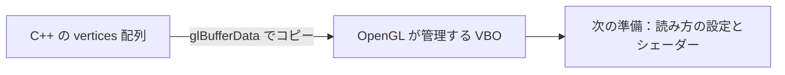

# 第4章：頂点データと VBO

[目次](../README.md) · [前の章](03_pipeline_and_coordinates.md) · [次の章](05_vao_and_vertex_attributes.md) · [早見表](reference.md)

## 実習：三角形の頂点と VBO

今回は、頂点データを OpenGL のバッファへ保存するところまでを扱う。VAO・シェーダー・描画命令は、この後の段階で追加する。

### 三つの頂点を用意する

既存の `glfwSetFramebufferSizeCallback(...)` の後、`while` に入る前に追加する。

```cpp
const float vertices[] = {
    -0.5f, -0.5f, 0.0f, // 左下
     0.5f, -0.5f, 0.0f, // 右下
     0.0f,  0.5f, 0.0f  // 上
};
```

1 頂点は `x, y, z` の 3 要素、全体では 3 頂点 × 3 要素 = 9 個の `float`。今回は全頂点の `z` を `0` にし、平面上の三角形を用意する。

後で、入力位置を変換せず `w = 1` で出力する頂点シェーダーを作る。そのため、今回指定する `x` と `y` は、結果として NDC（正規化デバイス座標）の値と同じになる。

| NDC の座標 | 視口の中での位置 |
| --- | --- |
| `(0, 0)` | 中心 |
| `x = -1` / `x = 1` | 左端 / 右端 |
| `y = -1` / `y = 1` | 下端 / 上端 |

これらの座標を実際のピクセル上の位置へ対応付けるのが、前の実習で設定した `glViewport()`。一般には、入力頂点 → 頂点シェーダーの出力するクリップ座標 → 透視除算による NDC → 視口変換によるピクセル座標、という順序を通る。

### VBO を使う理由

VBO は Vertex Buffer Object の略。描画に使う頂点データを、OpenGL が管理し GPU の処理から利用できる形で保持するために使う。

`vertices` は C++ の配列。この配列を宣言するだけでは、OpenGL の描画入力を用意したことにはならない。今回のようにアプリケーションで用意した頂点配列を Core Profile の頂点属性として使う場合、バッファにデータを置き、その読み方を設定して描画に使う。

初期化時に VBO へ一度コピーしておけば、同じ頂点データを各フレームの描画で再利用できる。

| 名前 | 実体・役割 |
| --- | --- |
| `vertices` | アプリケーション側にある、コピー元の C++ 配列 |
| VBO | OpenGL が管理する、描画材料の頂点データを保存するバッファ |
| `vbo` | そのバッファを指定するためにアプリケーションが保持する整数の ID |

以前のフレームバッファが描画結果を保存する先なのに対して、VBO は描画に使う入力データを保存する場所。

### 四行を一行ずつ理解する

頂点配列の直後に追加する。

```cpp
GLuint vbo = 0;
glGenBuffers(1, &vbo);
glBindBuffer(GL_ARRAY_BUFFER, vbo);
glBufferData(GL_ARRAY_BUFFER, sizeof(vertices), vertices, GL_STATIC_DRAW);
```

**1 行目：`GLuint vbo = 0;`**

OpenGL の管理番号を受け取る変数を用意する。`GLuint` は OpenGL が使う符号なし整数型。この行は C++ の変数を作るだけなので、VBO や頂点データの格納領域はまだ作られない。

**2 行目：`glGenBuffers(1, &vbo);`**

未使用のバッファ名（ID）を一つ取得する。`1` は個数、`&vbo` は取得した ID の保存先。関数の戻り値で ID を受け取るのではなく、関数が `vbo` に書き込む。

説明用に、取得した ID を `7` と仮定する。以降は `vbo == 7` で 7 番のバッファを指定できる。実際に取得する数値が 7 とは限らない。この段階で頂点データの格納領域はまだない。

**3 行目：`glBindBuffer(GL_ARRAY_BUFFER, vbo);`**

現在のコンテキストに、「`GL_ARRAY_BUFFER` への操作では、今から 7 番のバッファを使う」と記憶させる。これがここでのバインドの意味。

`GL_ARRAY_BUFFER` は操作対象を指定する定数で、頂点配列そのものやバッファの ID ではない。この名前に対して、現在操作するバッファを選ぶ。

取得した ID を初めてバインドすると、その名前に対応するバッファオブジェクトが作られる。ただし、頂点データ用の格納領域はまだ 0 バイト。

**4 行目：`glBufferData(GL_ARRAY_BUFFER, sizeof(vertices), vertices, GL_STATIC_DRAW);`**

現在 `GL_ARRAY_BUFFER` にバインドされているバッファ（この例では 7 番）に、データの格納領域を確保して配列の内容をコピーする。

| `glBufferData` の引数 | 今回の意味 |
| --- | --- |
| `GL_ARRAY_BUFFER` | 操作対象を選ぶための定数。直前にこの対象へバインドした VBO が使われる |
| `sizeof(vertices)` | 配列全体のバイト数。今回は 9 個の `float` で、この環境では 36 バイト。頂点数ではない |
| `vertices` | コピー元の配列の先頭アドレス |
| `GL_STATIC_DRAW` | データを主に一度用意し、何度も描画に使う予定というヒント |

`GL_STATIC_DRAW` は使い方のヒントで、データの変更を禁止する指定ではない。

`glBufferData()` の引数に `vbo` がないのは、直前の `glBindBuffer()` ですでに操作対象を選んでいるため。この「先に対象を選び、後の関数がその状態を使う」という形は、OpenGL で繰り返し出てくる。

| 実行した行 | 変数 `vbo` | OpenGL 側の状態（ID を 7 と仮定） |
| --- | --- | --- |
| 変数の用意 | `0` | このコードによるバッファの準備はまだない |
| ID の取得 | `7` | 名前 7 を取得。格納領域はまだない |
| バインド | `7` | 操作対象が 7 番。バッファオブジェクトが作られるが、格納領域は 0 バイト |
| データのコピー | `7` | 7 番に 36 バイトの格納領域を確保し、9 個の `float` をコピー |



VBO はここでは数値を保存する場所。まだ「3 個の float を一つの頂点として読む」という設定はしていない。その読み方を次に指定する。

### 使い終わったバッファを解放する

ループが終わった後、`glfwTerminate()` の直前に追加する。

```cpp
glDeleteBuffers(1, &vbo);
```

OpenGL のリソースを解放する処理は、そのコンテキストがまだ有効な間に行う。

### 今回の到達点

- [ ] 配列に 3 頂点・9 個の `float` を用意する。
- [ ] VBO の ID 取得 → バインド → データのコピーを、ループの前に追加する。
- [ ] ループ後、GLFW の終了前に VBO を削除する。
- [ ] ビルドして実行し、既存の背景色の表示と終了処理が引き続き動く。

今回の段階では、表示は背景色のまま。三角形を表示するための読み方の設定、シェーダー、描画命令を順に追加していく。

参考：[LearnOpenGL：Hello Triangle](https://learnopengl.com/Getting-started/Hello-Triangle)、[glGenBuffers の公式リファレンス](https://registry.khronos.org/OpenGL-Refpages/gl4/html/glGenBuffers.xhtml)、[glBindBuffer の公式リファレンス](https://registry.khronos.org/OpenGL-Refpages/gl4/html/glBindBuffer.xhtml)、[glBufferData の公式リファレンス](https://registry.khronos.org/OpenGL-Refpages/gl4/html/glBufferData.xhtml)。


---

[目次](../README.md) · [前の章](03_pipeline_and_coordinates.md) · [次の章](05_vao_and_vertex_attributes.md) · [早見表](reference.md)
