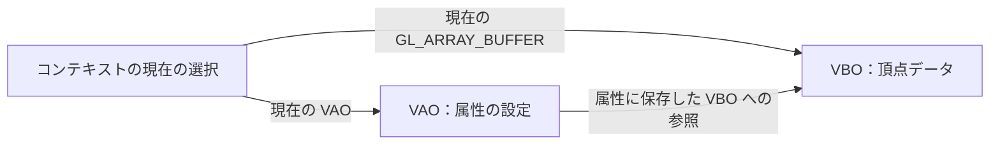

# 第5章：VAO と頂点属性

[目次](../README.md) · [前の章](04_vbo.md) · [次の章](06_vertex_shader.md) · [早見表](reference.md)

## 実習：VAO と頂点属性の読み方

パイプラインの「VBO の頂点データ → 頂点入力 → 頂点シェーダー」の間を準備する段階。

### なぜ読み方の設定が必要か

VBO が保持するのはバイト列。位置だけの数値なのか、位置と色が混ざっているのかは、バイト列だけでは決まらない。

| 一頂点の形式の例 | 保存する順序 | 次の位置データまでの間隔 |
| --- | --- | --- |
| 今回：位置のみ | `x, y, z` | 3 個の float、この環境では 12 バイト |
| 応用例：位置と色 | `x, y, z, r, g, b` | 6 個の float、この環境では 24 バイト |

そのため、どのバッファのどこから、どんな型を何個ずつ、何バイト間隔で読むかを指定する。これを頂点属性の設定という。

### なぜ VAO を使うか

VAO は Vertex Array Object の略。頂点の読み方、使用する VBO への参照、各属性の有効・無効などを記録する。

例えば位置のみの図形 A と、位置・色を持つ図形 B を描く場合、それぞれの VAO に読み方を記録しておけば、描く対象を変えるときに VAO を選び直せる。毎回すべての属性を設定し直す必要がなくなる。

VBO が頂点データを保持し、VAO はそのデータの読み方を保持する。VAO を作っても、VBO のデータが複製されるわけではない。

今回使う Core Profile では、頂点属性の設定を記録するときに、作成した VAO をバインドしておく。

### 「属性 0」とは何か

頂点属性（vertex attribute）は、一つの頂点に与える一種類の入力データ。例えば位置 `(x, y, z)` や色 `(r, g, b)` が、それぞれ一つの属性になる。

頂点シェーダーの入力には番号（location）があり、VAO はその番号ごとに、データをどの VBO からどう読むかを保持する。「VAO の属性 0 に記録する」とは、「VAO が持つ属性番号 0 の設定欄に、VBO への参照と読み方を記録する」という意味。

今回の属性 0 は、各頂点の位置を受け渡すために使う。

| 頂点 | 属性 0 として渡す位置 |
| --- | --- |
| 1 個目 | `(-0.5, -0.5, 0.0)` |
| 2 個目 | `( 0.5, -0.5, 0.0)` |
| 3 個目 | `( 0.0,  0.5, 0.0)` |

この座標の値は VBO にあり、VAO の属性 0 には、各頂点の座標を取り出すための設定がある。「0」は頂点の番号でも、x 成分の番号でも、VAO・VBO の ID でもない。三つの頂点すべての位置が、同じ属性番号 0 を通って頂点シェーダーに渡される。

```cpp
glVertexAttribPointer(0, 3, GL_FLOAT, GL_FALSE,
                      3 * sizeof(float), nullptr);
glEnableVertexAttribArray(0);
```

ここで最初の `0` は「属性番号 0 の読み方を設定する」、次の `3` は「その属性を三つの float として読む」という意味。位置の x・y・z をまとめて一つの属性として扱う。`glEnableVertexAttribArray(0)` も同じ番号の属性を有効化する。

これから作る頂点シェーダーでは、その接続先を次のように宣言する。

```glsl
layout (location = 0) in vec3 aPos;
```

`location = 0` が VAO 側の属性番号 0 に対応し、`vec3` は三つの float を持つ型、`aPos` はシェーダー内で使う変数名。番号を合わせることで、VBO から読み出した各頂点の位置が `aPos` に入る。

属性番号に「0 は位置」という固定の意味はない。今回は自分たちで位置に 0 を割り当てている。将来、頂点ごとの色も渡す場合は、例えば位置を属性 0、色を属性 1 に割り当て、それぞれの読み方とシェーダー入力を対応させる。

参考：[OpenGL 公式：glVertexAttribPointer の index 引数](https://registry.khronos.org/OpenGL-Refpages/gl4/html/glVertexAttribPointer.xhtml)、[LearnOpenGL：頂点シェーダーの入力と location](https://learnopengl.com/Getting-started/Hello-Triangle)。

### 応用例：位置と色を同じ VBO に保存する

VBO の中身を、一頂点ごとに `x, y, z, r, g, b` の順で繰り返して保存する場合。同じ頂点の複数の属性を交互にまとめる、このような配置をインターリーブ形式と呼ぶ。

```text
1 個目の頂点             2 個目の頂点
x0 y0 z0 r0 g0 b0  |  x1 y1 z1 r1 g1 b1  | ...
```

作成・データ保存済みの VBO と、作成済みの VAO に対して、次のように設定する。

```cpp
glBindBuffer(GL_ARRAY_BUFFER, vbo);
glBindVertexArray(vao);

glVertexAttribPointer(0, 3, GL_FLOAT, GL_FALSE,
                      6 * sizeof(float), nullptr);
glVertexAttribPointer(1, 3, GL_FLOAT, GL_FALSE,
                      6 * sizeof(float),
                      reinterpret_cast<const void*>(3 * sizeof(float)));

glEnableVertexAttribArray(0);
glEnableVertexAttribArray(1);
```

| 属性番号 | 読むデータ | 開始位置（offset） | 次の頂点の同じ属性までの間隔（stride） |
| --- | --- | --- | --- |
| 0 | 位置 x・y・z | 0 バイト | `6 * sizeof(float)` |
| 1 | 色 r・g・b | `3 * sizeof(float)` | `6 * sizeof(float)` |

色の先頭 r は、位置の三つの float の後ろにあるため、開始位置は `3 * sizeof(float)`。この環境では 12 バイト。次の頂点の色まで進むにも、一頂点分の六つの float（24 バイト）をまたぐので、位置と色の stride はどちらも同じになる。

最後の引数は「何個目の float か」ではなく、VBO の先頭からのバイト数。`static_cast<void*>(3)` は、一般の整数をポインターへ変換する書き方として使えない。また `reinterpret_cast<const void*>(3)` と書いても、3 バイトの位置を指定することになり、この配置には合わない。

ここでは、API が最後の引数を `const void*` 型で受け取るため、バイト数を `reinterpret_cast<const void*>(3 * sizeof(float))` の形で渡す。この VBO を使う設定では、OpenGL はその値をバイト単位の offset として扱う。

二つの `glVertexAttribPointer()` は、どちらも同じ VBO を参照し、異なる開始位置からデータを読む設定を、それぞれ VAO の属性 0 と属性 1 に記録する。両方の属性を使うため、それぞれを `glEnableVertexAttribArray()` で有効化する。

この設定に対応する頂点シェーダーの入力例：

```glsl
layout (location = 0) in vec3 aPos;
layout (location = 1) in vec3 aColor;
```

これは一頂点が六つの float で構成される場合の例。位置だけを三つの float で保存した現在の配列では、位置用の stride は引き続き `3 * sizeof(float)` を使う。

2026-10-24：上記の OpenGL 設定部分を、このプロジェクトの GLAD ヘッダーと C++17 で構文チェックし、成功した。描画結果は未確認。

参考：[OpenGL 公式：glVertexAttribPointer の stride・pointer 引数](https://registry.khronos.org/OpenGL-Refpages/gl4/html/glVertexAttribPointer.xhtml)。

### VBO・VAO のバインドと属性の記録の関係

バインドは「これからの操作に使う対象を選ぶ」こと。コンテキストには「現在の `GL_ARRAY_BUFFER` のバインド先」と「現在の VAO」という、独立した二つの選択がある。

| 呼び出し | 変更するもの |
| --- | --- |
| `glBindBuffer(GL_ARRAY_BUFFER, vbo)` | コンテキストの、バッファ操作や属性設定に使う `GL_ARRAY_BUFFER` の参照先 |
| `glBindVertexArray(vao)` | コンテキストの、現在設定・描画に使う VAO |
| `glVertexAttribPointer(0, ...)` | 現在の VAO の属性 0 に、現在の `GL_ARRAY_BUFFER` の VBO への参照と読み方を記録 |

VAO の選択を変えても、現在の `GL_ARRAY_BUFFER` のバインド先は変わらない。VBO を `GL_ARRAY_BUFFER` にバインドし直しても、現在の VAO の選択は変わらない。

例えば、作成済みの VAO と VBO を次のように選ぶ。

```cpp
glBindVertexArray(vao);              // 設定の保存先を選ぶ
glBindBuffer(GL_ARRAY_BUFFER, vbo);  // 読み出し元を選ぶ

glVertexAttribPointer(
    0, 3, GL_FLOAT, GL_FALSE,
    3 * sizeof(float), nullptr
);
glEnableVertexAttribArray(0);
```

`glVertexAttribPointer()` が、選択中の VAO と VBO を結び付ける瞬間。この例では、次の内容が VAO の属性 0 に記録される。以下は概念図で、実際の C++ の構造体ではない。

```text
vao の属性 0:
    読み出し元のバッファ = vbo
    要素数              = 3
    要素の型            = GL_FLOAT
    整数値の正規化      = GL_FALSE
    次の頂点までの間隔  = 3 * sizeof(float)（この環境では 12 バイト）
    開始位置            = 0 バイト
```

`glEnableVertexAttribArray(0)` は、この属性 0 を配列から読み出すように有効化する。これも現在の VAO に記録される。



コンテキストが現在選んでいる参照と、VAO の属性に保存した参照は別。`glVertexAttribPointer()` の後に別の VBO をバインドしても、属性 0 は元の VBO を参照し続ける。参照先を変更するには、目的の VAO と VBO を選び、もう一度 `glVertexAttribPointer()` を呼ぶ。

VAO に保存されるのは VBO への参照と読み方で、頂点データのコピーではない。これらの設定関数を呼んだ時点では、まだ描画は行われない。

### どの段階で使うか

1. **データの準備（初期化時・ループの前）**：VBO を選び、`glBufferData()` で配列をコピーする。この操作は現在の `GL_ARRAY_BUFFER` を使い、VAO の属性設定は参照しない。VAO のバインドは必要ない。
2. **読み方の準備（初期化時・ループの前）**：VAO を選び、読み出し元 VBO が `GL_ARRAY_BUFFER` に選ばれた状態で `glVertexAttribPointer()` を呼ぶ。続いて `glEnableVertexAttribArray()` で属性を有効化する。
3. **描画（シェーダー準備後・ループの中）**：必要な VAO を選び、描画命令を出す。頂点の読み出しには、VAO の属性に保存された VBO への参照と読み方が使われる。描画時点の `GL_ARRAY_BUFFER` のバインド先から読み出し元を選び直すわけではない。

最も大切なのは、`glVertexAttribPointer()` を呼ぶ瞬間に、設定の保存先の VAO と読み出し元の VBO が正しく選ばれていること。二つのバインドは互いの選択を変えないため、その前後順自体は固定ではない。

現在のコードのように、VBO へ先にデータをコピーし、その後 VAO を選んで属性を設定する順序も有効。間に別の VBO を選んでいなければ、2 回目の `glBindBuffer(GL_ARRAY_BUFFER, vbo)` は省略できる。残しても動作は同じ。

読み方と参照先が変わらなければ、`glVertexAttribPointer()` を毎フレーム呼ぶ必要はない。例えば波形表示で同じ VBO 内の座標だけを更新する場合、並び方が同じなら VAO の設定を再利用できる。別の図形の VBO や読み方を別の VAO に準備しておけば、描画時には VAO の切り替えで使い分けられる。

### 追加するコード

既存の `glBufferData(...)` の直後、`while` の前に追加する。

```cpp
GLuint vao = 0;
glGenVertexArrays(1, &vao);
glBindVertexArray(vao);

glVertexAttribPointer(
    0, 3, GL_FLOAT, GL_FALSE,
    3 * sizeof(float), nullptr
);
glEnableVertexAttribArray(0);
```

`glGenVertexArrays()` で VAO の ID を取得し、`glBindVertexArray()` でこれから設定する VAO を選ぶ。直前の VBO 準備で `GL_ARRAY_BUFFER` の対象はすでに `vbo` になっており、この VAO の選択ではそのバインド先は変わらない。

以前の例では VBO を明示し直すために、ここでも `glBindBuffer(GL_ARRAY_BUFFER, vbo)` を呼んでいた。しかし、この並びで間に別のバッファをバインドしていなければ、2 回目は同じ状態を設定するだけなので省略できる。

途中で別の VBO を `GL_ARRAY_BUFFER` にバインドしたり、`0` を指定してバインドを解除したりした場合は、`glVertexAttribPointer()` の前に、読み出し元にしたい VBO を選び直す。

`glVertexAttribPointer()` の引数：

| 引数 | 今回の意味 |
| --- | --- |
| `0` | シェーダーの属性入力番号（location）。頂点の番号ではない |
| `3` | この属性は一頂点あたり三要素、つまり x・y・z |
| `GL_FLOAT` | 各要素を float として読む |
| `GL_FALSE` | 整数データを浮動小数として読む際の正規化を有効にしない。今回の float データにはこの指定は影響しない |
| `3 * sizeof(float)` | 次の頂点の位置まで進むバイト数（stride）。今回は 12 バイト |
| `nullptr` | VBO の先頭からのバイト位置（offset）が 0、つまり先頭から読む |

ここでの `normalized` は整数値の変換についての指定で、NDC への座標変換とは別。最後の引数は、この VBO を使う設定では CPU 配列のアドレスではなく、VBO 内のバイト単位の位置として扱われる。

`glEnableVertexAttribArray(0)` は、属性 0 をバッファの配列から読むよう有効化する。読み方の指定と、配列の読み出しを有効にする操作は、それぞれ必要。

次に作る頂点シェーダーでは `layout (location = 0) in vec3 aPos;` と宣言する予定。番号 0 と三要素という設定を、その入力に合わせている。

VAO の属性へ VBO の参照を記録するのは、`glVertexAttribPointer()` を呼んだ時点。`glBindBuffer()` だけで属性へ記録されるわけではない。`GL_ARRAY_BUFFER` の現在のバインド先そのものは、VAO の切り替えで復元される状態ではない。

### 終了処理

ループ終了後、既存の `glDeleteBuffers(1, &vbo)` の直前に追加する。

```cpp
glDeleteVertexArrays(1, &vao);
```

### 今回の到達点

- [ ] VAO を作成し、VBO の位置属性の読み方を記録する。
- [ ] 属性番号、要素数、型、stride、offset の役割を確認する。
- [ ] 終了時に VAO を削除する。
- [ ] ビルド・実行し、既存の背景色と終了処理が動くことを確認する。

この段階の表示は背景色のまま。次に頂点シェーダーとフラグメントシェーダーを作り、準備した頂点データを描画に使う。

参考：[LearnOpenGL：頂点属性と VAO](https://learnopengl.com/Getting-started/Hello-Triangle)、[頂点属性の公式仕様](https://registry.khronos.org/OpenGL-Refpages/gl4/html/glVertexAttribPointer.xhtml)。


---

[目次](../README.md) · [前の章](04_vbo.md) · [次の章](06_vertex_shader.md) · [早見表](reference.md)
